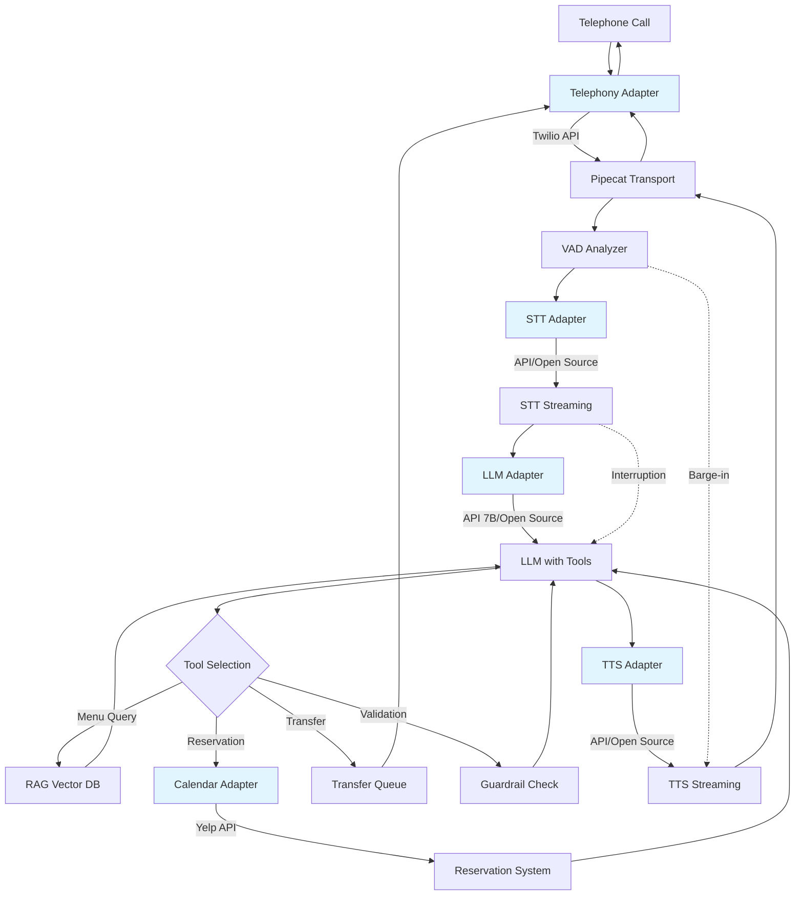

# Voice Restaurant Bot Architecture

## System Overview

A real-time voice telephone chatbot system for restaurant reservations with the following key capabilities:

- Handle reservation calls with natural conversation
- Query menu items from RAG database
- Book calendar events automatically via Yelp Reservation API
- Queue-based transfer to human staff when needed
- Guardrails against malicious manipulation
- Handle barge-in (interruptions) gracefully
- **Adapter pattern architecture** for easy migration from APIs to open-source models

## Architecture Philosophy

**API-First with Adapter Pattern**: Start with cloud APIs for reliability and low latency, but design all integrations using adapter interfaces. This allows seamless migration to open-source models (Qwen3-TTS, Whisper, Ollama) later without changing core application logic.

## Architecture Components

### 1. **Telephony Interface Layer** (Adapter Pattern)

- **Telephony Adapter Interface**: Abstract interface for telephony operations
  - `TelephonyAdapter` base class with methods: `connect()`, `transfer()`, `hangup()`, `get_audio_stream()`
- **Twilio Adapter** (Initial Implementation):
  - Twilio Voice API integration
  - Handles call routing, DTMF, call transfer
  - WebSocket streaming for real-time audio
- **Asterisk Adapter** (Future):
  - ARI (Asterisk REST Interface) or AMI integration
  - SIP trunking support
  - Same interface, different implementation
- **Audio Codec**: G.711 (PCMU/PCMA) or G.729 for telephone quality

### 2. **Real-Time Audio Pipeline** (Pipecat Framework)

```
Telephone → Transport → VAD → STT → LLM → TTS → Transport → Telephone
                ↓                                    ↑
            Barge-in Detection              Streaming Audio
```

**Components:**

- **Transport**: WebSocket/WebRTC adapter for telephony gateway
- **VAD (Voice Activity Detection)**: 
  - SileroVAD (open source) or WebRTC VAD
  - Detects speech start/end for barge-in
  - Configurable silence threshold
- **STT (Speech-to-Text)** - Adapter Pattern:
  - **STTAdapter Interface**: `transcribe_stream()`, `transcribe()`, `get_partial_results()`
  - **API Implementation (Initial)**: Deepgram Nova 3 or AssemblyAI (low latency, streaming)
  - **Open Source Adapter (Future)**: Whisper.cpp or Faster-Whisper adapter
  - Streaming mode with partial results for real-time transcription
- **TTS (Text-to-Speech)** - Adapter Pattern:
  - **TTSAdapter Interface**: `synthesize_stream()`, `synthesize()`, `cancel()`
  - **API Implementation (Initial)**: ElevenLabs, PlayHT, or Azure TTS (streaming support)
  - **Open Source Adapter (Future)**: Qwen3-TTS adapter with streaming
  - Streaming synthesis for low latency (<500ms first token)
  - Voice cloning for restaurant branding (optional)

### 3. **LLM Layer with Tool Calling** (Adapter Pattern)

**LLM Adapter Interface:**

- `LLMAdapter` base class: `chat()`, `chat_stream()`, `call_tool()`
- Unified interface for API and open-source models

**API Implementation (Initial):**

- **Primary**: Anthropic Claude 3.5 Sonnet (7B equivalent, low latency ~200-400ms)
- **Alternatives**: OpenAI GPT-4o-mini, Mistral API (7B, fast response)
- **Selection Criteria**: Low latency (<500ms), streaming support, tool calling
- Start with 7B-class models, upgrade to 70B later if needed

**Open Source Adapter (Future):**

- Ollama adapter for Llama 3.1 7B/70B, Mistral, or Qwen2.5
- Local inference with same interface

**Tool Functions:**

1. **`query_menu(question: str)`** → RAG database query
2. **`create_reservation(details: dict)`** → Calendar API (via adapter)
3. **`transfer_to_staff(reason: str)`** → Telephony transfer (queue-based)
4. **`validate_reservation_info(info: dict)`** → Guardrail check

### 4. **RAG Database for Menu**

**Vector Database:**

- **ChromaDB** or **Qdrant** (open source)
- Embeddings: **sentence-transformers** (all-MiniLM-L6-v2 or multilingual)

**Data Flow:**

```
Menu Items (JSON/CSV) → Embeddings → Vector DB
                                    ↓
User Query → Embed → Similarity Search → Context → LLM
```

**Menu Schema:**

- Item name, description, price, dietary info, availability

### 5. **Calendar Integration** (Adapter Pattern)

**Calendar Adapter Interface:**

- `CalendarAdapter` base class: `create_reservation()`, `check_availability()`, `cancel_reservation()`
- Unified interface for different calendar systems

**Yelp Reservation API (Initial Implementation):**

- Yelp Fusion API for restaurant reservations
- Create bookings with date/time, party size, customer info
- Conflict detection and availability checking
- Reservation confirmation handling

**Google Calendar Adapter (Future):**

- Google Calendar API integration
- Same interface, different backend
- Supports multiple calendar systems

**Reservation Schema:**

- Date/time, party size, customer contact (phone/email), special requests, dietary restrictions

### 6. **Guardrails & Safety**

**Multi-Layer Protection:**

1. **Input Validation**: 

   - Rate limiting per caller
   - Profanity filter
   - Intent classification (reservation vs. abuse)

2. **LLM Guardrails**:

   - System prompt with strict rules
   - Output filtering for sensitive operations
   - Confirmation required for bookings

3. **Behavioral Detection**:

   - Repeated failed attempts
   - Suspicious patterns (e.g., booking spam)
   - Escalation to human for review

### 7. **Staff Transfer System** (Queue-Based)

**Transfer Flow:**

```
Customer Request → LLM Detects Need → 
  → Add to Transfer Queue → 
  → Check Staff Availability → 
  → If Available: Warm Transfer (context passed) → 
  → Bridge Call → Staff Answers
  → If Unavailable: Hold in Queue, Notify Customer
```

**Queue-Based Implementation:**

- **Transfer Queue**: Priority queue for transfer requests
- **Staff Availability**: Real-time status tracking (available/busy/offline)
- **Context Passing**: Reservation details, conversation summary, customer info
- **Queue Management**: 
  - FIFO with priority (urgent requests first)
  - Estimated wait time for customer
  - Automatic callback if queue is long
- **Telephony Integration**: Via TelephonyAdapter (Twilio initially, Asterisk later)

### 8. **Barge-in Handling**

**Strategy:**

- **VAD triggers pause**: When user speech detected during TTS
- **STT streaming**: Immediate transcription of interruption
- **LLM context update**: Include interruption in next turn
- **TTS cancellation**: Stop current audio, start new response
- **State management**: Track conversation state during interruptions

**Pipecat Implementation:**

- Use `SmartTurnDetection` for turn management
- Configure VAD sensitivity for barge-in detection
- Handle partial TTS audio gracefully

## Data Flow Diagram



## Technology Stack

### Core Framework

- **Pipecat AI** (voice bot framework)
- **Python 3.13+**

### API Services (Initial Implementation)

- **STT**: Deepgram Nova 3 or AssemblyAI (streaming, low latency)
- **TTS**: ElevenLabs, PlayHT, or Azure TTS (streaming support)
- **LLM**: Anthropic Claude 3.5 Sonnet or OpenAI GPT-4o-mini (7B-class, low latency)
- **Telephony**: Twilio Voice API (with adapter pattern)
- **Calendar**: Yelp Reservation API (with adapter pattern)

### Open Source Components (Future Adapters)

- **STT Adapter**: Whisper.cpp or Faster-Whisper
- **TTS Adapter**: Qwen3-TTS (streaming)
- **LLM Adapter**: Llama 3.1 / Mistral / Qwen2.5 (via Ollama)
- **Telephony Adapter**: Asterisk/Freeswitch
- **Calendar Adapter**: Google Calendar API

### Core Components

- **VAD**: SileroVAD (open source)
- **RAG**: ChromaDB + sentence-transformers (open source)
- **Queue System**: Redis or in-memory queue for staff transfers

### Additional Libraries

- **asyncio**: Async audio processing
- **websockets**: Real-time communication
- **pydantic**: Data validation and adapter interfaces
- **langchain**: Optional RAG orchestration
- **redis**: Queue management (optional, can use in-memory)

## Key Design Decisions

1. **Adapter Pattern First**: All external services use adapter interfaces for easy migration
2. **API-First Approach**: Start with cloud APIs (low latency, reliable), migrate to open-source later
3. **Streaming Architecture**: All components support streaming for <500ms latency
4. **Modular Tools**: LLM uses function calling for extensibility
5. **State Management**: Track conversation state for context across interruptions
6. **Queue-Based Transfer**: Staff transfers use priority queue for better resource management
7. **Graceful Degradation**: Fallback to human if LLM/STT fails
8. **Cloud Deployment**: Initial deployment on cloud (AWS/GCP), local deployment adapter ready

## Implementation Phases

### Phase 1: Adapter Infrastructure & Core Pipeline

- Define adapter interfaces (Telephony, STT, TTS, LLM, Calendar)
- Implement Twilio telephony adapter
- Set up Pipecat with API-based STT/TTS adapters
- Basic conversation loop with streaming

### Phase 2: LLM Integration & Tool Calling

- Implement LLM adapter (API-based, 7B model)
- Integrate tool calling framework
- Basic reservation handling conversation flow

### Phase 3: RAG & Calendar Integration

- Set up ChromaDB vector database
- Create sample menu data and embeddings
- Implement Yelp calendar adapter
- End-to-end reservation flow with menu queries

### Phase 4: Advanced Features

- Barge-in handling with VAD and TTS cancellation
- Queue-based staff transfer mechanism
- Guardrails implementation (rate limiting, validation)

### Phase 5: Production Readiness

- Error handling & retries for all adapters
- Logging & monitoring
- Performance optimization
- Load testing and latency tuning

## Configuration Requirements

### API Credentials (Initial)

- **Twilio**: Account SID, Auth Token, Phone Number
- **STT API**: Deepgram/AssemblyAI API key
- **TTS API**: ElevenLabs/PlayHT/Azure API key
- **LLM API**: Anthropic/OpenAI API key
- **Yelp API**: Yelp Fusion API key

### Adapter Configuration

- **Active Adapters**: Which implementation to use (API vs open-source)
- **Adapter-specific settings**: Endpoints, timeouts, retry policies

### System Configuration

- **Vector DB path/URL** (ChromaDB local or cloud)
- **VAD sensitivity** (tunable for barge-in)
- **Guardrail thresholds** (rate limits, validation rules)
- **Queue settings** (max wait time, priority rules)
- **Deployment**: Cloud provider settings (AWS/GCP)

## Adapter Pattern Implementation Details

### Adapter Interface Structure

```python
# Example adapter interface pattern
class TelephonyAdapter(ABC):
    @abstractmethod
    async def connect(self, call_sid: str) -> AudioStream
    @abstractmethod
    async def transfer(self, call_sid: str, target: str, context: dict) -> bool
    @abstractmethod
    async def hangup(self, call_sid: str) -> None

class TwilioAdapter(TelephonyAdapter):
    # Twilio-specific implementation
    
class AsteriskAdapter(TelephonyAdapter):
    # Asterisk-specific implementation (future)
```

### Benefits of Adapter Pattern

1. **Easy Migration**: Switch providers by changing configuration
2. **Testing**: Mock adapters for unit testing
3. **Flexibility**: Mix and match (e.g., Twilio + open-source TTS)
4. **Future-Proof**: Add new providers without changing core logic

## Sample Menu Data Structure

```json
{
  "items": [
    {
      "name": "Grilled Salmon",
      "description": "Fresh Atlantic salmon with lemon butter sauce",
      "price": 28.99,
      "category": "Main Course",
      "dietary": ["gluten-free"],
      "allergens": ["fish"],
      "available": true
    }
  ]
}
```

## Decision Summary

✅ **Telephony**: Twilio (with Asterisk adapter for future)

✅ **LLM**: API-based 7B model (low latency provider), 70B later

✅ **Deployment**: Cloud first, local adapter ready

✅ **Menu Data**: Sample data to be created

✅ **Calendar**: Yelp Reservation API (with Google Calendar adapter)

✅ **Transfer**: Queue-based system